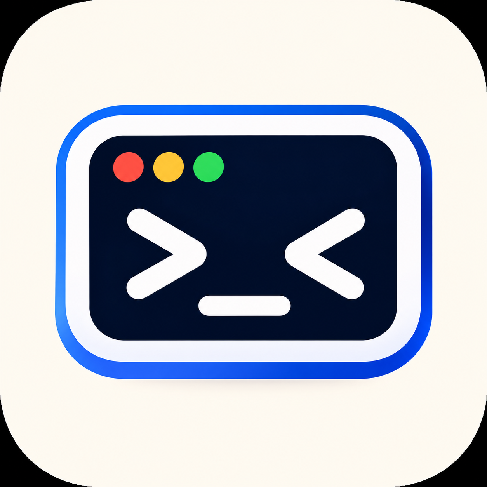

<div align="center">



# LiveCode

**Kod qanday ishlashini qadamma-qadam ko'ring.**

C dasturini satrma-satr bajarib, o'zgaruvchilar, massivlar, sikllar, pointerlar va structlarni jonli animatsiyada ko'rsatadigan, boshlovchilar uchun mo'ljallangan vizual o'quv platformasi.

[**Sinab ko'rish →**](https://livecode-chi.vercel.app/)


🇺🇿 O'zbekcha · 🇷🇺 Русский · 🇬🇧 English

</div>

---

## Mundarija

- [Nima uchun LiveCode?](#nima-uchun-livecode)
- [Imkoniyatlar](#imkoniyatlar)
- [Qo'llab-quvvatlanadigan C](#qollab-quvvatlanadigan-c)
- [Texnologiyalar](#texnologiyalar)
- [Ishga tushirish](#ishga-tushirish)
- [Buyruqlar](#buyruqlar)
- [Loyiha tuzilishi](#loyiha-tuzilishi)
- [Qanday ishlaydi](#qanday-ishlaydi)
- [Hissa qo'shish](#hissa-qoshish)

---

## Nima uchun LiveCode?

Dasturlashni endi boshlagan o'quvchi uchun eng qiyin narsa — kompyuter kodni **qanday tartibda** bajarishini va har bir qatordan keyin xotirada **nima o'zgarishini** tasavvur qilish. LiveCode shu jarayonni ko'rinadigan qiladi:

- hozir bajarilayotgan qator muharrirda yoritiladi;
- o'zgaruvchilar va ularning qiymatlari ko'rsatiladi, o'zgarganda belgilanadi;
- massivga o'qish/yozish animatsiya bilan ko'rsatiladi;
- sikl jarayoni kuzatiladi (*Iteratsiya 3 / 5*);
- `printf` natijasi konsolda yig'ilib boradi;
- har bir qadam uchun oddiy tilda qisqa izoh beriladi.

Hammasi **brauzerning o'zida** ishlaydi: server, ro'yxatdan o'tish yoki kompilyator o'rnatish shart emas.

## Imkoniyatlar

| Bo'lim | Tavsif |
|---|---|
| **Playground** | Ikki panelli ish maydoni: chapda VS Code uslubidagi muharrir, o'ngda bajarilish paneli (o'zgaruvchilar, massivlar, sikl, konsol, izoh). Run, Previous / Next, Auto Play, tezlikni sozlash. |
| **Examples** | Tayyor dasturlar: yig'indi, maksimum, faktorial, Fibonachchi, bubble sort, matritsa. To'g'ri yechimni qadamma-qadam o'rganish uchun. |
| **Masalalar** | Mavzular bo'yicha (shartlar, `while`, `for`, massivlar, funksiyalar) masalalar. O'quvchi o'z dasturini yozadi yoki berilgan dasturdagi xatoni tuzatadi, so'ng **Tekshirish** tugmasi uni test holatlari bilan solishtiradi. Progress va nishonlar (badges). |
| **Learn** | Vositadan qanday foydalanish haqida qisqa tushuntirish. |

Qo'shimcha:

- 🌐 **Uch til** — interfeys, qadam izohlari va xato xabarlari o'zbek, rus va ingliz tillarida; tilni almashtirsangiz, ekrandagi matn darhol yangilanadi.
- 🌓 **Yorug' / qorong'i mavzu** — sahifa yuklanishida "oq chaqnash"siz.
- 👉 **Pointer strelkalari** — pointer o'zi ko'rsatayotgan o'zgaruvchiga strelka bilan bog'lanadi, har bir qutida soxta manzil (`0x100`, `0x104`, …) ko'rsatiladi.
- 🧱 **Struct qutilari** — har bir struct nomlangan maydonlari bilan bitta quti sifatida chiziladi; structlar massivi alohida ko'rinishda.
- ⌨️ **`scanf` kiritish** — dasturda `scanf` bo'lsa, muharrir ostida Input maydoni paydo bo'ladi.
- 🖼️ **Kodni rasm sifatida eksport qilish** va nusxa olish.
- ♿ **Accessibility** — klaviatura bilan boshqarish, `prefers-reduced-motion` hurmat qilinadi.
- 🛑 **Cheksiz sikldan himoya** — dastur 1000 qadam bilan cheklangan, sahifa qotib qolmaydi.

## Qo'llab-quvvatlanadigan C

LiveCode haqiqiy C kompilyatori emas — u C tilining o'quv uchun tanlangan qismini bajaradigan **o'z interpretatoriga** ega.

<details>
<summary><b>Qo'llab-quvvatlanadi</b></summary>

- `int`, `float`, `char` o'zgaruvchilar; 1D va 2D massivlar
- arifmetik, taqqoslash va mantiqiy operatorlar; `++`, `+=` va h.k.
- `if` / `else if` / `else`, `switch` / `case` / `default` (fall-through bilan)
- `for`, `while`, `break`, `continue`
- funksiyalar (rekursiyasiz), prototiplar, massiv va pointer parametrlar
- pointerlar: `&x`, `*p`, `NULL`, `swap(&a, &b)`
- structlar: ichma-ich structlar, massiv maydonlar, structlar massivi, `->`
- `printf` (`%d %f %c %s %p`), `puts`, `scanf` (`%d %f %s`)
- `<stdlib.h>`: `rand`, `srand` · `<time.h>`: `time(NULL)`
- `<ctype.h>`: `isdigit`, `isalpha`, `isupper`, `islower`, `isspace`, `toupper`, `tolower`
- `<string.h>`: `strlen`, `strcmp`, `strcpy`, `strcat`
- `sizeof` (`int`/`float`/`char`, o'zgaruvchilar va massivlar)

</details>

<details>
<summary><b>Hozircha qo'llab-quvvatlanmaydi</b></summary>

Pointer arifmetikasi, pointerga pointer, `malloc`/`free`, rekursiya, `double`/`long`, bitli operatorlar, funksiya pointerlari va boshqalar. Bunday konstruksiya uchraganda dastur *"Hozircha qo'llab-quvvatlanmaydi: …"* xabarini qator raqami va nima yozish kerakligi haqidagi maslahat bilan ko'rsatadi.

</details>

To'liq spetsifikatsiya: [AGENTS.md → The Interpreter](AGENTS.md#the-interpreter).

## Texnologiyalar

| Vazifa | Kutubxona |
|---|---|
| Build | [Vite](https://vite.dev) |
| UI | [React 19](https://react.dev) + TypeScript (strict) |
| Stil | [Tailwind CSS 4](https://tailwindcss.com) |
| Kod muharriri | [CodeMirror 6](https://codemirror.net) (`@uiw/react-codemirror`, `@codemirror/lang-cpp`) |
| Animatsiya | [Framer Motion](https://motion.dev) |
| State | [Zustand](https://zustand.docs.pmnd.rs) |
| Testlar | [Vitest](https://vitest.dev) |
| Lint | [Oxlint](https://oxc.rs) |
| Analitika (ixtiyoriy) | [PostHog](https://posthog.com) |

## Ishga tushirish

**Talablar:** Node.js 20.19+ yoki 22.12+ (Vite 8 talabi) va npm.

```bash
git clone https://github.com/BaxromBobokulov/LiveCode.git
cd LiveCode
npm install
npm run dev
```

So'ng brauzerda Vite ko'rsatgan manzilni oching (odatda `http://localhost:5173`).

### Muhit o'zgaruvchilari (ixtiyoriy)

Analitika uchun `.env.example` faylidan nusxa oling:

```bash
cp .env.example .env
```

```env
VITE_POSTHOG_KEY=phc_your_project_api_key
VITE_POSTHOG_HOST=https://us.i.posthog.com
```

Qiymatlardan biri bo'sh qolsa, analitika o'chiriladi va ilova odatdagidek ishlaydi. Analitikaga o'quvchining kodi, o'zgaruvchi nomlari yoki qiymatlari **hech qachon yuborilmaydi**.

## Buyruqlar

| Buyruq | Vazifasi |
|---|---|
| `npm run dev` | Dev serverni ishga tushirish (HMR bilan) |
| `npm run build` | Production build (`dist/`) |
| `npm run preview` | Build natijasini lokal ko'rish |
| `npm run lint` | Oxlint bilan tekshirish |
| `npm run typecheck` | TypeScript tiplarini tekshirish |
| `npm test` | Vitest testlarini ishga tushirish |

## Loyiha tuzilishi

```txt
src/
├── engine/          # C interpretatori: lexer → parser → interpreter, izohlar, xatolar
├── data/
│   ├── examples/    # Tayyor misollar (qo'lda yozilgan trace'lar)
│   └── problems/    # Masalalar va ularning test holatlari
├── features/
│   ├── playground/  # Muharrir, bajarilish paneli, vizualizatorlar
│   ├── examples/    # Examples ekrani
│   ├── problems/    # Masalalar ekrani, Tekshirish logikasi, nishonlar
│   └── learn/       # Learn ekrani
├── components/      # Umumiy UI komponentlar (Button, Tabs, Tooltip, …)
├── store/           # Zustand store'lar (playground, sozlamalar, nishonlar)
├── i18n/            # UZ / RU / EN tarjimalar
├── theme/           # Rang, oraliq, radius va tipografiya tokenlari
├── lib/             # Analitika
└── constants/       # Layout, playback va havolalar
```

## Qanday ishlaydi

```txt
 C kodi ──► lexer.ts ──► parser.ts ──► interpreter.ts ──► Step[] ──► UI
                                            │
                                       explain.ts
                                  (har bir qadam uchun izoh)
```

1. **Run** bosilganda kod bir marta to'liq bajarilib, `Step[]` — qadamlar ro'yxati — hosil qilinadi. Har bir qadamda: joriy qator, o'zgaruvchilar holati, massiv ko'rinishi, sikl ma'lumoti, konsol natijasi va izoh bor.
2. **Previous / Next / Auto Play** shu tayyor ro'yxat bo'ylab harakatlanadi, kodni qayta bajarmaydi — shuning uchun `rand()` natijalari ham bitta Run ichida o'zgarmaydi.
3. Izohlar tayyor jumla emas, balki tarjima kaliti va qiymatlardan iborat `Phrase` sifatida saqlanadi; UI ularni tanlangan tilda ko'rsatadi.
4. Xatolar ikki turga bo'linadi: `UnsupportedConstructError` (til imkoniyati hali yo'q) va `CodeError` (o'quvchi dasturidagi xato: nolga bo'lish, massiv chegarasidan chiqish, `NULL` pointer va h.k.).

## Hissa qo'shish

1. Kod yozishdan oldin [AGENTS.md](AGENTS.md) ni to'liq o'qing — barcha arxitektura, UI va stil qoidalari o'sha yerda.
2. `dev` branchidan yangi branch oching.
3. O'zgarishni kichik va aniq doirada saqlang.
4. PR ochishdan oldin tekshiring:

   ```bash
   npm run lint && npm run typecheck && npm test
   ```

5. Yangi npm paket qo'shishdan oldin issue orqali muhokama qiling.
6. `src/engine/types.ts` dagi `Step` shaklini o'zgartirsangiz, `src/data/examples/` dagi barcha fayllarni ham shu o'zgarishda yangilang.

Rejadagi ishlar: [docs/scope/scope.md](docs/scope/scope.md).

---

<div align="center">

Savollar bo'yicha: [Telegram guruhi](https://t.me/livecode_uz) · O'yinlar: [game.livecode.uz](https://game.livecode.uz)

</div>
